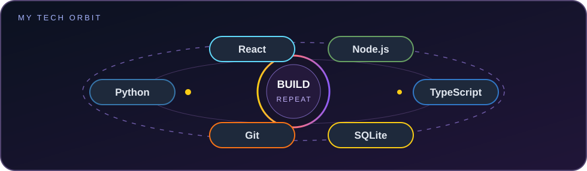
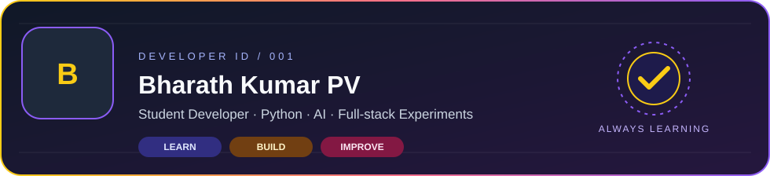
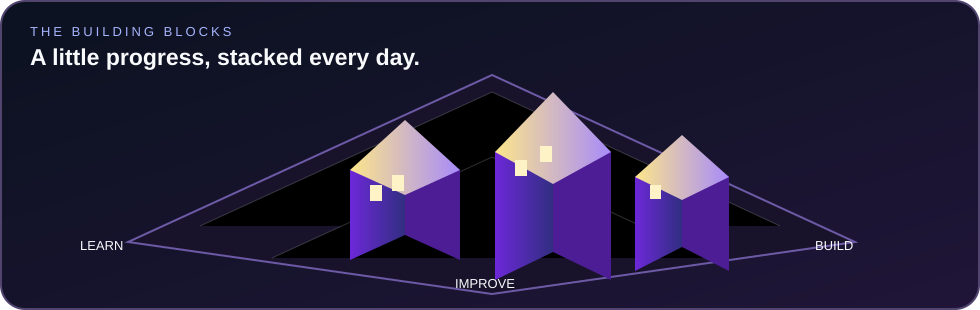

  

<table>
  <tr>
    <td width="38%" align="center" valign="middle">
      
    </td>
    <td width="62%" valign="middle">
      <h1>Hey, I'm Bharath! 👋</h1>
      
<strong>Student developer · Python · Offline AI · Full-stack experiments</strong>

      
I enjoy learning by building practical projects, exploring how local AI works, and solving problems one step at a time.

      
Right now, I'm focused on Python, data structures and algorithms, and building useful applications.

      

        
        
      

    </td>
  </tr>
</table>

---

## 02 · WHAT I BUILD

<table>
  <tr>
    <td width="33%" valign="top">
      <h3>🧠 Offline AI</h3>
      
Local-first assistant experiments, document workflows, retrieval, and OCR.

      Current project: <a href="https://github.com/BharathKumarPV/Server-Down-AH-42-PagePilot">PagePilot</a>
    </td>
    <td width="33%" valign="top">
      <h3>🌐 Full-stack apps</h3>
      
Web interfaces, APIs, databases, and prototypes that solve practical problems.

      Project: <a href="https://github.com/BharathKumarPV/Mini-Project">KisanConnect</a>
    </td>
    <td width="33%" valign="top">
      <h3>🧩 Problem solving</h3>
      
Python practice, data structures, algorithms, and learning through implementation.

      <a href="https://github.com/BharathKumarPV/leetcode-solutions">LeetCode solutions</a>
    </td>
  </tr>
</table>

---

## 03 · OUTSIDE THE EDITOR

---

## 04 · TECH ORBIT

  
  
  
  
  
  
  
  

---

## 05 · DEVELOPER ID & DASHBOARD

<strong>NOW BUILDING</strong> PagePilot — an offline-first Windows AI assistant. The project is actively evolving; see its repository for implementation notes and current status.

  
  

---

## 06 · PROJECTS & CONTRIBUTION LANDSCAPE

| Project | What it is | Status / notes |
|---|---|---|
| [PagePilot](https://github.com/BharathKumarPV/Server-Down-AH-42-PagePilot) | Offline-first Windows AI assistant with local chat and document-intelligence work | In development; see repository for details |
| [KisanConnect](https://github.com/BharathKumarPV/Mini-Project) | Agriculture-market information and farmer-to-buyer marketplace prototype | Demo authentication is not production-ready |
| [LeetCode solutions](https://github.com/BharathKumarPV/leetcode-solutions) | Algorithm and data-structure practice | Ongoing learning repository |
| [QR Generator](https://github.com/BharathKumarPV/Qr-Genarator) | Browser-based QR code generator | Small web project |

The isometric city is a visual motif. The contribution calendar below is the live GitHub activity chart.

  

---

## 07 · LET'S CONNECT

<table>
  <tr>
    <td width="55%" align="center" valign="middle">
      
    </td>
    <td width="45%" valign="middle">
      <h2>Have an idea to build?</h2>
      
I'm always open to learning, collaborating, and creating useful things.

      

      
<a href="https://github.com/BharathKumarPV?tab=repositories">Browse all public repositories →</a>

    </td>
  </tr>
</table>

Built with curiosity, consistency, and a lot of commits.

