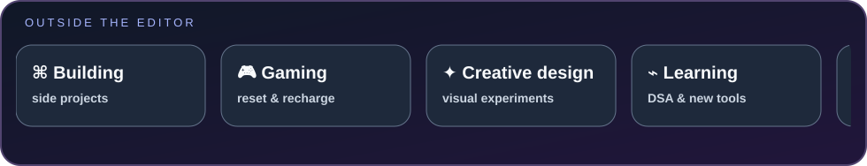

<div align="center">
  
  <h1>Hey, I'm Bharath Kumar PV</h1>
  <p><strong>Student Developer · Artificial Intelligence & Data Science · Python · Offline AI · Full-Stack</strong></p>
  <p>
    <a href="https://bharathkumarsportfolio.vercel.app"></a>
    <a href="https://github.com/BharathKumarPV?tab=repositories"></a>
  </p>
</div>

<table>
  <tr>
    <td width="34%" align="center" valign="middle">
      
    </td>
    <td width="66%" valign="middle">
      <h2>01 · WHO AM I?</h2>
      <p>I'm a B.E. student in <strong>Artificial Intelligence & Data Science</strong> at <strong>Don Bosco Institute of Technology (DBIT), Bengaluru</strong>, graduating in 2028.</p>
      <p>I learn by building: experimenting with local AI, developing full-stack applications, and improving my problem-solving skills one project at a time.</p>
    </td>
  </tr>
</table>

```bash
$ whoami
name      : Bharath Kumar PV
education : B.E. Artificial Intelligence & Data Science — DBIT, Bengaluru
building  : offline AI tools and practical full-stack applications
learning  : Python, data structures, Linux and DevOps fundamentals
```

---

## 02 · PROJECTS I'M BUILDING

| Project | What it does | Status |
|---|---|---|
| [PagePilot](https://github.com/BharathKumarPV/Server-Down-AH-42-PagePilot) | Windows-first, offline AI assistant focused on local chat, PDF/document intelligence, evidence-backed answers, OCR/formula recognition, and DOCX workflows. | In development |
| [KisanConnect](https://github.com/BharathKumarPV/Mini-Project) | Agriculture-market platform prototype for mandi-price tracking, market comparison, and a farmer-to-buyer marketplace. | Prototype · [Live website](https://kisanconnect-app.vercel.app/) |
| [Personal Portfolio](https://github.com/BharathKumarPV/portfolio) | Interactive 3D portfolio using Three.js and WebGL to showcase my work. | Live · [Open portfolio](https://bharathkumarsportfolio.vercel.app) |
| [LeetCode Solutions](https://github.com/BharathKumarPV/leetcode-solutions) | Python solutions and problem notes organised by difficulty. | Ongoing practice |

<sub>Project status is intentionally kept conservative. Visit each repository for implementation details. KisanConnect authentication is demo functionality and is not production-ready; do not enter real or sensitive passwords on the demo site.</sub>

---

## 03 · TECH STACK

<p><strong>Languages</strong><br />
  
  
  
</p>

<p><strong>Frontend & Backend</strong><br />
  
  
  
  
  
</p>

<p><strong>AI, Data & Tools</strong><br />
  
  
  
  
  
  
  
</p>

<p><strong>Current learning focus:</strong> Linux/Ubuntu, DevOps fundamentals, data structures and algorithms, and practical AI/ML workflows.</p>

---

## 04 · GITHUB ACTIVITY

<div align="center">
  
  
</div>

<p align="center">
  
</p>

---

## 05 · OUTSIDE THE EDITOR



---

## 06 · LET'S CONNECT

<table>
  <tr>
    <td width="42%" align="center" valign="middle">
      
    </td>
    <td width="58%" valign="middle">
      <h2>Have an idea to build?</h2>
      <p>I'm interested in learning, collaborating, and building useful software.</p>
      <p><a href="https://github.com/BharathKumarPV">GitHub profile</a> · <a href="https://github.com/BharathKumarPV?tab=repositories">All repositories</a> · <a href="https://bharathkumarsportfolio.vercel.app">Portfolio</a></p>
    </td>
  </tr>
</table>

<p align="center"><sub>Built with curiosity, steady practice, and a lot of commits.</sub></p>
